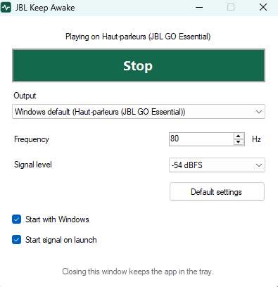

# JBL Keep Awake

A lightweight Windows 10 and 11 utility that plays a quiet tone to help keep your JBL speaker from turning off during silence.



## Quick start

1. On GitHub, select **Code → Download ZIP** and extract the folder.
2. Double-click **JBLKeepAwake.exe** in the extracted folder.
3. Under **Output**, choose your JBL speaker or leave **Windows default** selected, then click **Start**.

Click **Stop** to end the signal. Closing the window keeps the app in the notification area. Double-click its tray icon to reopen it, or right-click and choose **Exit** to quit.

## Settings

| Setting | What it does |
| --- | --- |
| **Output** | Switch speakers in the app. If the selected speaker disconnects, playback waits for it to return. |
| **Frequency** | Adjust the tone from 40 to 200 Hz. Press Enter after typing a value. |
| **Signal level** | Raise it one step if the speaker still turns off. Lower it if you can hear the tone. |
| **Default settings** | Restore **80 Hz** and **−54 dBFS**. |
| **Start with Windows** | Open the app when you sign in. Off by default. |
| **Start signal on launch** | Start playback whenever the app opens. Off by default. |

With **Windows default** selected, the current output stays in use until you stop playback. Click **Stop**, then **Start** to use a new Windows default output.

> **Windows 11** may block the current unsigned executable when Smart App Control is enabled.

## Build from source

Run this from the repository root on Windows.

```powershell
.\source\build.bat
```

The script uses the Windows .NET Framework C# compiler and writes **JBLKeepAwake.exe** to the repository root.

JBL Keep Awake is an independent utility.
